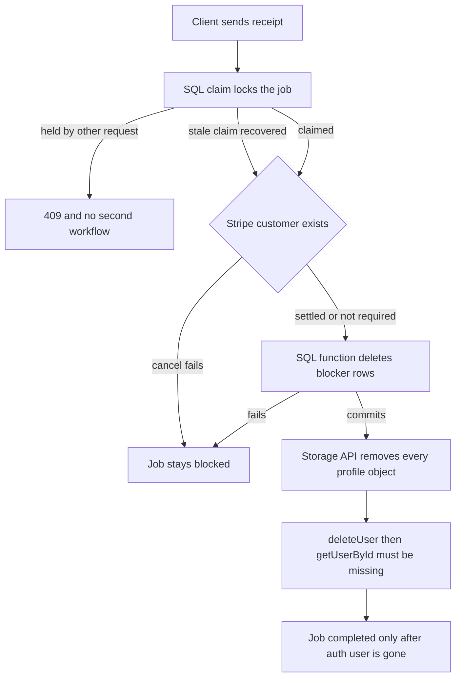

# Account deletion implementation

Local `PMAbackend` `main` is on `704cba0`, the commit Render is running. This document is the implementation plan. The code is not written yet. Do not push, do not run this SQL on production, and do not deploy until that is approved separately.

## Why deletion fails

`auth.admin.deleteUser` fails while `public.users` still points at `auth.users` with `ON DELETE NO ACTION`. Production has 35 of those rows.

`lifestyle_scores.user_id` and `onboarding_questions.user_id` point at `public.users` with `ON DELETE NO ACTION`. Those rows have no child tables. They must be removed before `public.users` can be removed.

These tables already use `ON DELETE CASCADE` from `auth.users` and must not be deleted by hand:

- `user_profiles`
- `profiles`
- `daily_missions`
- `daily_points`
- `progress`
- `user_ranks`
- `ai_weekly_reports`

`user_profiles` holds `apple_original_transaction_id`. It stays until `deleteUser` commits, so another account cannot claim that Apple subscription in the middle of deletion.

`storage.objects` does not reference `auth.users`. The `protect_objects_delete` trigger blocks a direct SQL delete of storage rows. Profile pictures are removed only through the Storage API.

`onboarding_questions` is not used by the current app code. The app stores onboarding on `user_profiles.onboarding_data`. The table still blocks deletion.

## Flow



## Database

Add `PMAbackend/sql/migration_account_deletion.sql`. Do not execute it in this step.

`public.deletion_jobs` has no foreign key to `auth.users`:

- `user_id` primary key
- `receipt_hash` unique
- `claim_token`
- `claimed_at`
- `state`: `in_progress`, `blocked`, or `completed`
- `stripe_status`
- `storage_status`
- `stripe_customer_id`
- `storage_prefix`
- `last_error`
- `expires_at`
- timestamps

No email. No Apple transaction id. Enable row level security and grant no client policies. The service role is the only writer.

`public.claim_deletion_job` locks the row with `SELECT FOR UPDATE`:

- One request receives the claim.
- A second request with a fresh claim gets `in_progress` or `receipt_mismatch` and does not run the workflow.
- A claim older than 5 minutes can be taken again.
- The same receipt retries a `blocked` job immediately.
- A different receipt cannot replace an active claim until that claim is stale.

`public.delete_account_blockers(uuid)` is one transaction:

1. Delete `lifestyle_scores` for that id.
2. Delete `onboarding_questions` for that id.
3. Delete `public.users` for that id.

Zero rows is success. Grant execute to `service_role` only.

## Non-atomic boundary

`delete_account_blockers` and `auth.admin.deleteUser` are two commits. If the process stops between them, `public.users` is already gone and the auth user, `user_profiles`, and the Apple transaction id are still there.

A retry runs the blocker function again. It deletes nothing. Then `deleteUser` cascades `user_profiles`. A missing `public.users` row is not proof that the auth user is gone. The job becomes `completed` only after `getUserById` reports that the auth user is missing. Never call `.delete()` on `user_profiles`.

## Handler

Replace `POST /auth/delete-account` in `PMAbackend/src/routes/auth.routes.js` with `PMAbackend/src/services/accountDeletionService.js`.

Receipts:

- The client sends 43 to 128 URL-safe characters.
- The server stores only the SHA-256 hash.
- A bad receipt on the delete route is 400.
- The hash expires 24 hours after the job is created.
- The same receipt retries the same job.
- A different receipt is rejected while the claim is fresh.
- After the claim is stale, a new receipt may replace it.
- After expiry, status lookups return `unknown`. A still-authenticated user may start again with a new receipt.

Account lock:

- While `state` is `in_progress` or `blocked`, `authenticateToken` returns 409 for every authenticated route except `POST /auth/delete-account`.
- Sign-out does not use that middleware, so it still works.
- If `deletion_jobs` does not exist yet, the lock check does not take down the rest of the API.

Stripe:

- Read `billing_provider` and `stripe_customer_id` only.
- Never send `subscription_id` to Stripe. For Apple, that column is the original transaction id.
- If `stripe_customer_id` is null, skip Stripe. That covers Apple and free accounts.
- If it is set, list that customer's subscriptions with `starting_after` until a short page, and cancel only ids from that list.
- `resource_missing` means the subscription is already canceled.
- Any other Stripe error sets the job to `blocked` and returns 503. `deleteUser` does not run.
- An Apple TestFlight subscription is not a reason to block deletion. It does not appear on Apple's subscription page and ends on Apple's test schedule.

Blocker cleanup:

- After Stripe is settled or not required, call `delete_account_blockers`.
- If that throws, set the job to `blocked` and return 503.

Storage:

- List every object under `profile-pictures/{userId}` in pages of 100.
- Remove them with the Storage API.
- A storage error sets `storage_status` to `pending` and does not stop `deleteUser`.

Auth delete:

- Call `deleteUser`.
- If it says the user is missing, call `getUserById`.
- Mark `completed` only when that lookup also says the user is missing.
- If the user is still present, leave the job `in_progress` and return 503.
- Updates that finish or block the job must match `claim_token`, so a worker that lost the claim cannot complete it.

Storage sweep:

- `POST /internal/deletion-storage-sweep` retries every job with `storage_status` `pending`.
- Require header `x-deletion-sweep-token` equal to the `DELETION_SWEEP_TOKEN` environment variable.
- Never hardcode that token.
- The route returns counts only.
- If the variable is unset, the route returns 503 and process start logs that pending storage jobs stay unresolved until a scheduler calls the route.
- That scheduler is a Render cron after a later deploy. Until then, calling the route is a manual operational requirement. Pending rows and the log are the record.
- The sweep also deletes `completed` jobs whose storage is settled and whose receipt has expired.

Status:

- `POST /auth/delete-account/status` with body `{ receipt }`.
- Unauthenticated.
- Compare the hash and return only `{ state: "completed" | "pending" | "unknown" }`.
- Missing, malformed, and expired receipts all return `unknown` with the same body.
- Do not log the raw receipt.
- Do not return a user id, email, or error detail.

## App and policy

In `frontend/app/(tabs)/settings/index.tsx` and `frontend/lib/accountDeletion.ts`:

- Generate a 32-byte receipt with `crypto.getRandomValues`.
- Save it in AsyncStorage before the post, and reuse it for retries and the status check.
- On `{ success: true }` or a status of `completed`, clear the receipt and call `signOut`.
- On a timeout or a response with no HTTP status, call the status endpoint.
- Sign out only when that status is `completed`.
- `pending` stays on the account screen and is not reported as success.
- `unknown` says deletion could not be confirmed and does not sign out.
- Add `/auth/delete-account/status` to the public API routes so a dead access token cannot block that check.
- Replace the alert sentence that says any subscription will be canceled. The account and app data are deleted. An Apple subscription is canceled in App Store settings. A TestFlight subscription does not appear there and ends on Apple's test schedule. A Stripe subscription is canceled by the server first.

Update section 4 of `PMAbackend/public/policy/delete-account.html` to the same meaning.

## Docs and secrets

Add `PMAbackend/docs/service-role-rotation.md` with the rotation steps only. No token and no project URL from `PMAbackend/sql/migration_add_cron_job.sql`.

Add `PMAbackend/docs/account-deletion-ops.md` describing the sweep route, `DELETION_SWEEP_TOKEN`, and the manual call required until a scheduler exists.

Do not open, copy, or reuse the service-role JWT in the cron migration.

## Tests

Add `PMAbackend/tests/account-deletion.test.js` and run:

```text
node --test tests/account-deletion.test.js
```

Use injected fakes. Do not run the older scripts that hit a live server. Do not delete a real account.

Cover:

- An Apple account never calls Stripe and never deletes `user_profiles` before `deleteUser`.
- Stripe success paginates and cancels only listed ids.
- A Stripe error blocks `deleteUser`.
- A free account skips Stripe.
- A blocker-function failure can be retried.
- A second overlapping claim does not run the workflow.
- A stale claim can be recovered.
- A missing `public.users` row still requires `getUserById` to be empty before `completed`.
- `deleteUser` reporting not-found while the auth user still exists stays incomplete.
- A storage failure still deletes the auth user, and the sweep route retries the files.
- A sweep without the env token returns 503 and leaves the job pending.
- A lost-response status returns `completed` with no user id.
- Expired, unknown, and repeated status calls stay enumeration-safe.
- A different receipt is rejected while a claim is fresh.
- Authenticated routes other than delete-account are blocked while a job is active.
- After the SQL function and before `deleteUser`, the Apple profile row is still present.

## Stop

Leave `migration_account_deletion.sql` unrun. Leave `main` unpushed. Report the changed files, the test output, and the remaining risk: production keeps failing until that SQL is applied and the branch is deployed.
